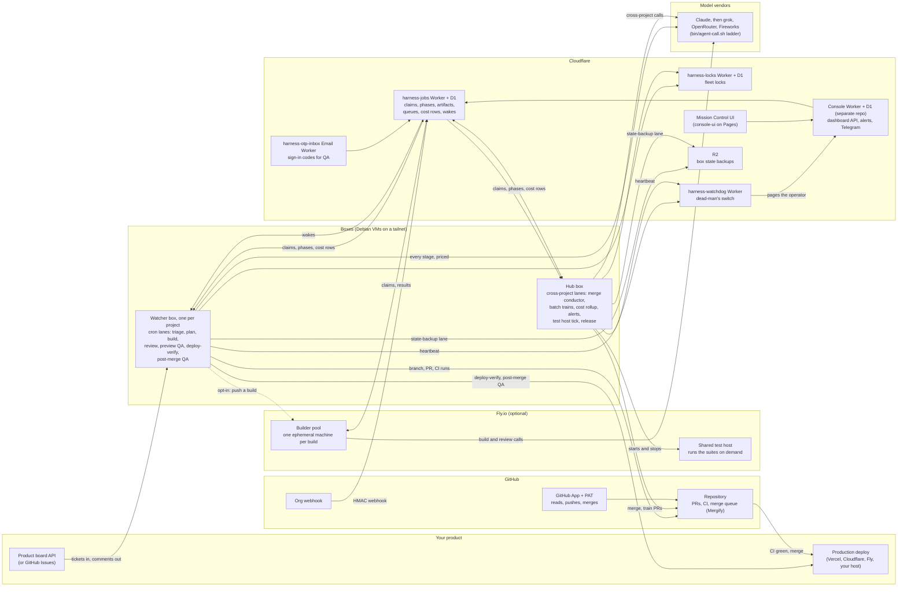

# How the parts connect

This page is the map. It names each part of a running Cromford fleet, where it
runs, what it holds, and which other parts it talks to. Read it before
[docs/OPERATOR-SETUP.md](OPERATOR-SETUP.md) (how to stand the parts up) or
[docs/RUN-BUILD-GRAPH.md](RUN-BUILD-GRAPH.md) (what one build does step by
step).

## One picture

## The parts

| Part | Runs on | Holds | Talks to | Source |
|---|---|---|---|---|
| **Watcher box** | A Debian VM, one per project or one shared by small projects. Boxes reach each other over a tailnet. | That project's secrets (`env/<project>.env`), its prompts, its build directories, its logs. | The product board, GitHub, the jobs worker, the model vendors, the production URL. | `bin/run-triage.sh`, `bin/run-build.sh`, `bin/review-prs.sh`, `bin/e2e-smoke.sh`, `bin/deploy-train.sh`, `bin/postmerge-qa.sh`; lanes with `scope: project` in `catalog/lanes.d/` |
| **Hub box** | One watcher box that also runs the cross-project lanes. It runs no agent build work of its own. | The fleet registry export, the Vercel deploy snapshot (watcher boxes hold no Vercel credential), the cost rollups, the alert state. | GitHub (merges and train PRs), the jobs worker, the console, the Fly API. | Lanes with `scope: hub` (134 at this writing): `bin/merge-conductor.sh`, `bin/batch-resolve.sh`, `bin/cost-rollup.sh`, the alert lanes, `bin/testhost-tick.sh` |
| **Jobs worker and D1** (`harness-jobs`) | Cloudflare Worker over one D1 database. | Build claims, stage phases, artifacts, queues, lane budgets, cost rows, wake events, OTP messages. This is the coordination plane. | Every box and every Fly machine, over HTTPS with a bearer secret. GitHub sends it the org webhook, signed with an HMAC. | `worker/jobs/`, [docs/DB-COORDINATION-SPEC.md](DB-COORDINATION-SPEC.md), [docs/EVENTS.md](EVENTS.md) |
| **Locks worker and D1** (`harness-locks`) | Cloudflare Worker over its own D1 database. | Fleet-wide locks with a mint cap. | Boxes. | `locks-worker/` |
| **Watchdog worker** (`harness-watchdog`) | A separate Cloudflare Worker, on purpose: a bad deploy of it never takes down the console or the relay. | The last heartbeat from each box. | Boxes (heartbeats in), the console or the operator (pages out). | `worker/watchdog/`, [docs/watchdog-spec.md](watchdog-spec.md), [docs/OUTSIDE-DEADMAN.md](OUTSIDE-DEADMAN.md) |
| **OTP inbox worker** (`harness-otp-inbox`) | A Cloudflare Email Worker behind Email Routing on a catch-all domain. | One row per sign-in email, in the jobs D1. | The jobs worker, which serves `GET /api/otp` so a QA run can sign in to the app it tests. | `worker/otp-inbox/` |
| **Console** (`harness-console`) | A Cloudflare Worker over D1, in its own repository, not published here yet. | The dashboard API, the alert ledger, the Telegram and Slack bindings, the MCP routes. | The jobs worker, the boxes, Telegram, the operator's MCP client. | [docs/ABOUT.md](ABOUT.md) (what is not here), [docs/MCP.md](MCP.md) |
| **Mission Control UI** (`console-ui/`) | A static site on Cloudflare Pages with a Functions proxy to the console. | Nothing. It renders what the console serves. | The console. | `console-ui/` |
| **R2 state backup** | Cloudflare R2. | Each box's `env/`, `state/`, `logs/`, `flags/`, build summaries and the orchestrator checkout. | The `state-backup` lane on every box. | `bin/state-backup.sh`, `bin/state-restore.sh`, [docs/RESTORE.md](RESTORE.md) |
| **Fly builder pool** (optional) | One ephemeral Fly machine per build (`performance-8x`, 16 GB). | Nothing after the build. The machine gets a short-lived GitHub credential, builds, reports its result to the jobs worker, and stops. | The jobs worker, GitHub, the model vendors. | `bin/fly-pool.sh`, `fly/`, [docs/FLY-POOL.md](FLY-POOL.md) |
| **Fly test host** (optional) | One shared Linux machine on Fly, started by the hub when a run needs it and stopped after half an hour idle. | Nothing durable. | The hub and any operator laptop that runs `bin/remote-gate.sh`. | [docs/REMOTE-GATE.md](REMOTE-GATE.md) |
| **GitHub** | github.com | The repositories, the PRs, CI (GitHub Actions), the merge queue (Mergify, a GitHub App). | Every box; the jobs worker (webhook). | [docs/AUTH.md](AUTH.md), [docs/MERGIFY.md](MERGIFY.md), [docs/GH-REST.md](GH-REST.md) |
| **Model vendors** | The vendors' APIs. | Nothing of ours. | `bin/agent-call.sh` on a box or a Fly machine. Every call writes a priced row to `logs/cost.csv`; `bin/cost-rows-push.sh` ships the rows to the jobs D1 every 10 minutes. | [docs/ACCOUNT-ROUTING.md](ACCOUNT-ROUTING.md), [docs/MODEL-ROUTES.md](MODEL-ROUTES.md), [COST.md](../COST.md) |
| **Your product** | Wherever you deploy it. | Its product board (or GitHub Issues), its preview deploys, its production URL. | The watcher box reads tickets and writes comments through the board API. Deploy-verify and post-merge QA read the production URL. | [docs/BOARD-API-CONTRACT.md](BOARD-API-CONTRACT.md), [docs/onboarding-a-repo.md](onboarding-a-repo.md) |
| **Box provider** | Any VM host. The reference fleet uses Orgo, which takes a daily disk snapshot of each box. | The disks. | Nothing in the pipeline. The snapshot is the coarse recovery layer; the R2 backup is the fine one. | [docs/RESTORE.md](RESTORE.md), [docs/ADDING-A-BOX.md](ADDING-A-BOX.md) |

## One ticket, end to end

1. A person files a ticket on the product board, or opens a GitHub Issue with the `ai-build` label.
2. The watcher box's `triage` lane reads the whole thread on its cron tick, or at once when the org webhook wakes it through the jobs worker. It decides RUN or SKIP with a script first and a model second.
3. `plan` writes the change down, ending in named acceptance tests. The build claims the ticket in the jobs D1, so no second box takes it.
4. `build` runs on the watcher box, or on a Fly pool machine when the pool is on. It pushes a branch and opens a PR on GitHub. CI runs there.
5. `review` runs an adversarial pass in a session that never saw the build. The verdict is bound to the PR head.
6. `preview QA` loads the PR's own preview deployment and clicks through it.
7. The hub's merge conductor merges tier 1 PRs that are approved and green, alone or in a batch train through Mergify. Tier 2 waits for a person.
8. `deploy-train` confirms a production deployment followed the merge. `post-merge QA` drives the production URL and checks the shipped behaviour is there.
9. The watcher box writes the close-out comment on the ticket with links to the PR and the production screen.

Every stage writes its phase and its priced model calls to the jobs D1, so the console and Mission Control show the ticket's state without reading a box.

## Trust boundaries

- A watcher box holds one project's secrets and nothing else. The hub holds the cross-project credentials (Vercel read access, the Fly API token).
- A Fly pool machine receives a short-lived GitHub credential for one build (`fly/gh-credential.sh`) and the project's build-time env. It holds no long-lived secret.
- The jobs, locks and watchdog workers authenticate every call with a bearer secret. The GitHub webhook is the one unauthenticated route, and it checks an HMAC over the raw body.
- GitHub reads go through a GitHub App installation token. Pushes and merges the App cannot do use a PAT ([docs/AUTH.md](AUTH.md)).
- The watchdog is a separate Worker from the console on purpose, so a bad console deploy cannot silence the alarm.

## What you need, and what is optional

| Required | Optional |
|---|---|
| One box (it is the hub and the watcher at once) | More watcher boxes, one per project |
| The jobs worker and its D1 | The Fly builder pool and the Fly test host |
| The watchdog worker | The console, Mission Control and the MCP server |
| A GitHub repository, a GitHub App and a PAT | Mergify as the merge queue |
| One model vendor account | The vendor ladder |
| A product board or GitHub Issues | The OTP inbox worker, the Vercel deploy snapshot, R2 backups, Orgo snapshots, Telegram and Slack |

[docs/SELF-HOST.md](SELF-HOST.md) walks through the required set on your own
accounts. [docs/optional-services.md](optional-services.md) lists each optional
service and what you lose without it.
